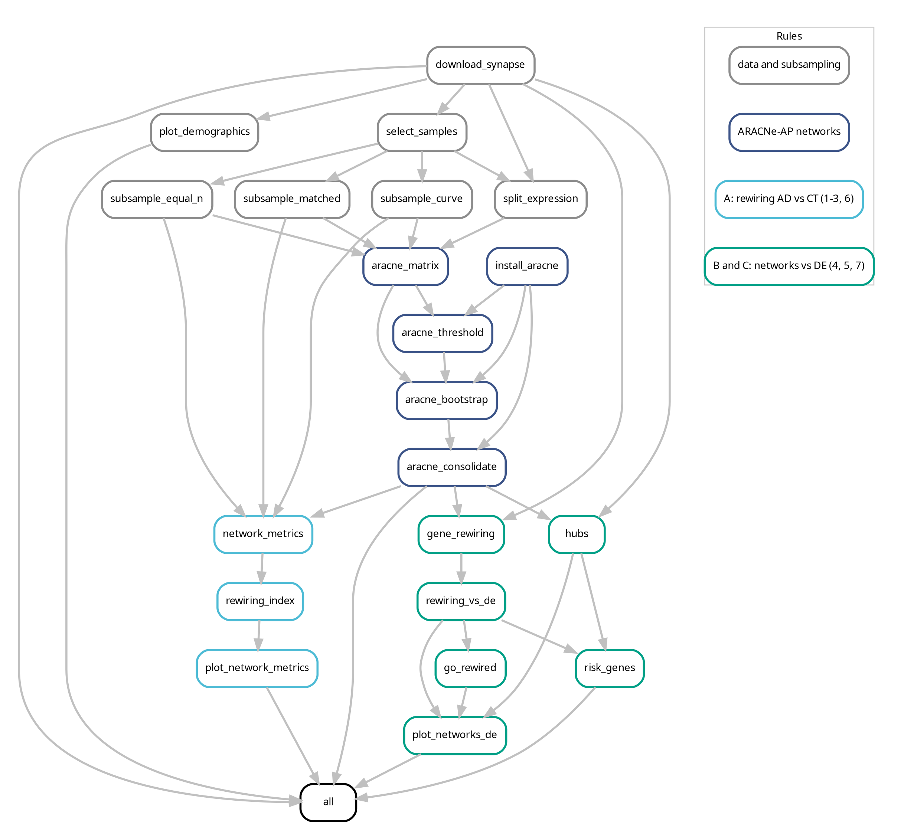

# Region-specific co-expression network rewiring in Alzheimer's disease

## Goal

Measure how Alzheimer's disease (AD) changes gene co-expression networks in five brain regions (DLPFC, ACC, PCC, TCX and CBE), in a way that is comparable between regions, and relate those changes to differential expression and to known AD biology.

The full design is in [`docs/experimental_design.md`](docs/experimental_design.md).

## Requirements

- [Conda](https://github.com/conda-forge/miniforge) (or mamba).
- Snakemake 9, from the driver environment:
  ```
  conda env create -f workflow/envs/ad-networks-smk.yaml
  conda activate ad-networks-smk
  ```
  Every rule has its own conda environment (`workflow/envs/`), created by Snakemake.
- A [Synapse](https://www.synapse.org) account with access to the AMP-AD RNA-seq Harmonization Study (`syn26720676`), and a personal access token in the `SYNAPSE_AUTH_TOKEN` environment variable.

## Run

`N` = cores, `M` = RAM in GB the jobs may use. Each ARACNe-AP bootstrap takes 4 threads and 16 GB, so at most min(N/4, M/16) run at the same time.

1. Open a session that survives a disconnection, activate the environment and set the token:
   ```
   tmux new -s ad                 # back later: tmux attach -t ad
   conda activate ad-networks-smk
   read -s SYNAPSE_AUTH_TOKEN && export SYNAPSE_AUTH_TOKEN
   ```
2. Create all the conda environments:
   ```
   snakemake --sdm conda --conda-create-envs-only --cores 1
   ```
3. Check what will run (dry-run):
   ```
   snakemake networks_matched networks_curve --sdm conda -n
   ```
4. Matched and reference-curve networks (the long step):
   ```
   snakemake networks_matched networks_curve --sdm conda --cores N --resources mem_gb=M --keep-going --rerun-incomplete
   ```
5. Figure 2 and risk genes (they need only the matched networks):
   ```
   snakemake networks_vs_de --sdm conda --cores N
   ```
6. Equal-n networks:
   ```
   snakemake networks_equal_n --sdm conda --cores N --resources mem_gb=M --keep-going --rerun-incomplete
   ```
7. Everything else (Figures 1, S1, S3 and S4):
   ```
   snakemake --sdm conda --cores N
   ```

If a run is interrupted, run `snakemake --unlock` and repeat the same command: Snakemake resumes where it stopped. Logs are in `logs/` and `results/**/logs/`.

## Pipeline



Grey: data and subsampling. Dark blue: ARACNe-AP networks. Light blue: rewiring between AD and CT (analyses 1–3 and 6). Green: networks vs differential expression and AD risk genes (analyses 4, 5 and 7). The analyses are summarized in [`docs/analisis.md`](docs/analisis.md).

To redraw the graph after changing the pipeline: `python workflow/scripts/pipeline_rulegraph.py` (needs Graphviz).

## Repository structure

```
config/
  config.yaml          parameters of every analysis
  synapse_files.tsv    Synapse files to download
  ad_risk_genes.tsv    AD risk genes (Bellenguez et al., 2022)
docs/
  experimental_design.md   study design and methods
  analisis.md              summary table of the analyses
  paper_design.md          figures, panels and captions
  figures/                 design diagrams, pipeline graph and the hand-made panel 1a
workflow/
  Snakefile            all rules
  envs/                conda environments
  scripts/             R scripts (scripts/R/: shared helpers)
resources/             downloaded data (not versioned)
results/               outputs (not versioned); figures in results/figures/
```

## References

- AMP-AD RNA-seq Harmonization Study. Synapse `syn26720676`.
- Allen M, et al. (2016). Human whole genome genotype and transcriptome data for Alzheimer's and other neurodegenerative diseases. *Scientific Data* 3:160089.
- Bellenguez C, et al. (2022). New insights into the genetic etiology of Alzheimer's disease and related dementias. *Nature Genetics* 54:412–436.
- Bennett DA, et al. (2018). Religious Orders Study and Rush Memory and Aging Project. *Journal of Alzheimer's Disease* 64(s1):S161–S189.
- Lachmann A, et al. (2016). ARACNe-AP: gene network reverse engineering through adaptive partitioning inference of mutual information. *Bioinformatics* 32:2233–2235.
- Mölder F, et al. (2021). Sustainable data analysis with Snakemake. *F1000Research* 10:33.
- Traag VA, et al. (2019). From Louvain to Leiden: guaranteeing well-connected communities. *Scientific Reports* 9:5233.
- Wu T, et al. (2021). clusterProfiler 4.0: a universal enrichment tool for interpreting omics data. *The Innovation* 2:100141.
