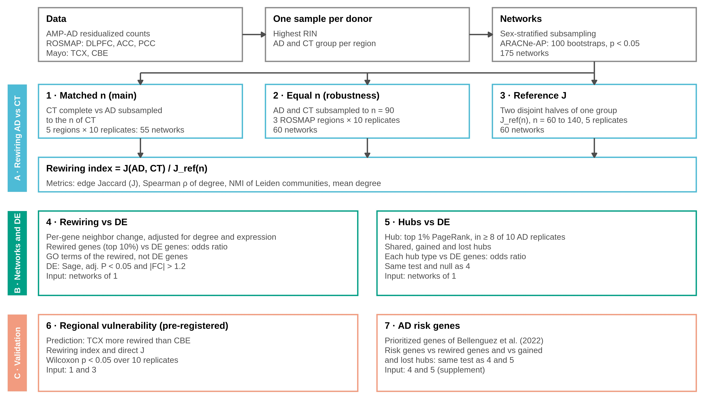
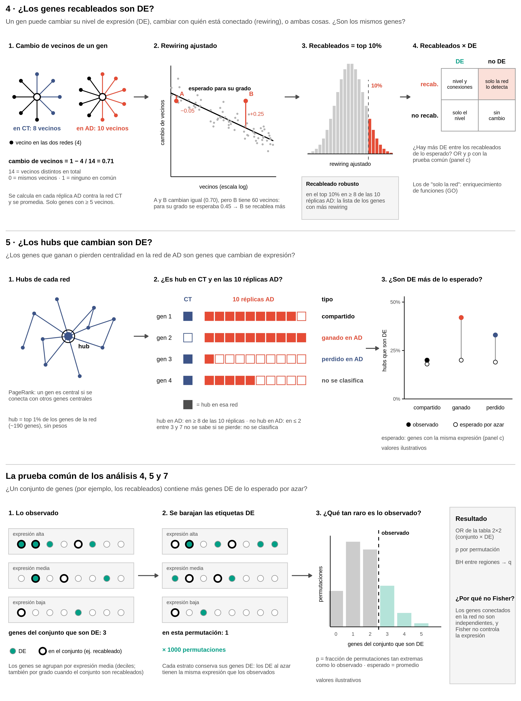

# Diseño experimental

## Título

**Rewiring de redes de co-expresión específico de región en la enfermedad de Alzheimer**

## Motivación

La enfermedad de Alzheimer (AD) no afecta a todo el cerebro por igual ni al mismo tiempo. Los ovillos neurofibrilares aparecen primero en el lóbulo temporal medial y después se extienden al neocórtex (Braak y Braak, 1991). El cerebelo, en cambio, queda relativamente preservado. Si la enfermedad altera la regulación génica, es esperable que esa alteración también sea distinta en cada región.

El análisis de expresión diferencial (DE) detecta genes que cambian su **nivel** de expresión entre AD y controles (CT). No detecta cambios en la **coordinación** entre genes: dos genes pueden mantener su nivel y dejar de variar juntos. Las redes de co-expresión representan esa coordinación, y la diferencia entre la red de AD y la de CT (el **rewiring**) mide cuánto cambia.

Estudios previos construyeron redes o módulos de co-expresión en varias regiones del cerebro con AD (Zhang et al., 2013; Wan et al., 2020). Comparar el rewiring **entre regiones** tiene dos problemas metodológicos:

1. **El tamaño de muestra cambia la red.** Con más muestras, un método de inferencia de redes tiene más poder y detecta más enlaces. Dos redes con distinto n difieren aunque no exista ninguna diferencia biológica.
2. **No hay una referencia de similitud.** Dos redes inferidas con personas distintas nunca son idénticas, aunque vengan del mismo grupo. Sin saber cuánto se parecen dos redes sin diferencia biológica, un valor de similitud entre AD y CT no se puede interpretar.

Este diseño compara el rewiring entre regiones con el n igualado y con una referencia de similitud medida empíricamente. Además, relaciona el rewiring con la expresión diferencial y lo contrasta con lo que ya se sabe de AD.

## Preguntas

**Pregunta principal:** ¿cambia la conectividad de las redes de co-expresión entre AD y CT de forma distinta en cada región del cerebro?

**Preguntas específicas:**

1. ¿Cuánto rewiring hay entre AD y CT en cada región, con el mismo n en ambas redes? (análisis 1)
2. ¿El orden de las regiones por rewiring depende del n? (análisis 2)
3. ¿Qué similitud se espera entre dos redes cuando no hay diferencia biológica, y cuánto rewiring queda después de descontarla? (análisis 3)
4. ¿Los genes que más se recablean son los genes DE, o la red detecta genes que el DE no ve? (análisis 4)
5. ¿Los hubs que se ganan o se pierden en AD son genes DE? (análisis 5)
6. ¿El rewiring sigue la vulnerabilidad regional conocida de AD? (análisis 6)
7. ¿Los genes de riesgo genético de AD están entre los genes que cambian en la red? (análisis 7)

## Objetivo

**Objetivo general:** cuantificar el rewiring de las redes de co-expresión entre AD y CT en cinco regiones del cerebro, de forma comparable entre regiones, y relacionarlo con la expresión diferencial y con la biología conocida de AD.

**Objetivos específicos:**

1. Medir el rewiring AD vs CT por región, controlando el tamaño de muestra, la proporción de sexos y la variación debida a qué personas se eligen (análisis 1–3).
2. Determinar si los genes que cambian en la red son los mismos que cambian de nivel de expresión (análisis 4 y 5).
3. Validar los resultados contra una predicción registrada de antemano y contra los genes de riesgo genético de AD (análisis 6 y 7).

## Datos

### Expresión

- **Fuente:** AMP-AD RNA-seq Harmonization Study (Synapse, `syn26720676`).
- **Cohortes y regiones:**
  - ROSMAP (Bennett et al., 2018): corteza prefrontal dorsolateral (DLPFC), corteza cingulada anterior (ACC) y corteza cingulada posterior (PCC).
  - Mayo (Allen et al., 2016): corteza temporal (TCX) y cerebelo (CBE).
- **MSBB no se incluye:** sus archivos residualizados no están disponibles por correcciones en la metadata.
- **Matriz de expresión:** conteos residualizados `(diagnosis)` del pipeline `sageseqr` de Sage. Están corregidos por sexo, edad, PMI, RIN, métricas de secuenciación, batch e individuo, y conservan el efecto de diagnóstico × región. El modelo exacto está en `resources/metadata/*_Configuration_file.yml`.
- **Universo de genes:** todos los genes de la matriz de cada estudio, 18,859 en ROSMAP y 19,437 en Mayo.
- **Definición de AD y CT:** la armonizada por Sage, a partir de Braak, CERAD y el diagnóstico cognitivo. Se excluyen los diagnósticos OTHER (ROSMAP), PSP y PATH_AGE (Mayo).

### Unidad de análisis: una muestra por donante

Hay 8 donantes con dos muestras de la misma región (7 en DLPFC y 1 en PCC), secuenciadas en batches distintos. Si se usaran ambas, la misma persona contaría dos veces en una red. **De cada donante se conserva la muestra con mayor RIN.** Si hay empate, se conserva la de `specimenID` que va primero en orden alfabético.

### Tamaños de grupo (donantes)

| Estudio | Región | AD | CT | ¿≥100 en ambos? |
|---|---|---|---|---|
| ROSMAP | DLPFC | 289 | 141 | sí |
| ROSMAP | ACC | 171 | 94 | casi |
| ROSMAP | PCC | 150 | 99 | casi |
| Mayo | TCX | 80 | 68 | no |
| Mayo | CBE | 79 | 65 | no |

### Expresión diferencial

Son los resultados de DE de Sage (`resources/DE/{study}_Differential_Expression_(diagnosis).tsv`):
- Hay **una comparación AD vs CT por región**: `AD_DLPFC - CT_DLPFC`, `AD_ACC - CT_ACC`, `AD_PCC - CT_PCC`, `AD_TCX - CT_TCX` y `AD_CBE - CT_CBE`.
- Cada comparación incluye todos los genes de la matriz de su estudio, es decir, el mismo universo de genes que las redes.
- Columnas que se usan: `ensembl_gene_id` (para unir con las redes, que usan IDs de Ensembl), `logFC`, `t`, `AveExpr`, `adj.P.Val` y `hgnc_symbol` (para reportar los genes por nombre).
- Sage calculó el DE con **todas las muestras** de cada región, sin quitar a los donantes con dos muestras y sin submuestrear. Es una firma de expresión externa a las redes.

**Definición de gen DE:** `adj.P.Val` < 0.05 **y** \|FC\| > 1.2, es decir, \|`logFC`\| > log2(1.2) ≈ 0.263. Son los mismos umbrales que usó Sage (`de p-value threshold: 0.05` y `de FC: 1.2` en `resources/metadata/*_Configuration_file.yml`).

| Región | DE (`adj.P.Val` < 0.05) | DE (`adj.P.Val` < 0.05 y \|FC\| > 1.2) |
|---|---|---|
| DLPFC | 5,831 | 706 |
| ACC | 4,676 | 719 |
| PCC | 5,139 | 1,147 |
| TCX | 10,108 | 5,475 |
| CBE | 7,099 | 3,029 |

Cada gen se clasifica en su región como **DE arriba** (sube en AD), **DE abajo** (baja en AD) o **no DE**.

### Genes de riesgo genético de AD

Son los genes priorizados por Bellenguez et al. (2022), de su Tabla Suplementaria 20: los **55 genes Tier 1 y Tier 2** de los **42 loci nuevos** que reporta ese estudio. La lista está en `config/ad_risk_genes.tsv` (símbolo, ID de Ensembl, locus y tier), así que no hace falta traducir símbolos.

**Decisión: se usan solo los genes de los 42 loci nuevos.** Los 33 loci ya conocidos antes de ese estudio (por ejemplo APOE, BIN1, CLU o TREM2) no están en la Tabla Suplementaria 20 y no se incluyen.

## Principios del diseño

### Qué es una red

Cada red es **una corrida completa de ARACNe-AP** (Lachmann et al., 2016) **sobre un grupo de personas**:

1. Recibe la matriz de expresión de esas personas.
2. Hace 100 bootstraps: re-sortea con reemplazo esas mismas personas y arma una red en cada vuelta.
3. Consolida: conserva los enlaces que aparecen en suficientes bootstraps, con **p < 0.05**.
4. Entrega **una lista de enlaces**. Esa lista es la red que se compara.

**Todos los genes se usan como reguladores.** Por eso ARACNe puede reportar A→B y también B→A. En todos los análisis, cada par de genes cuenta como un solo enlace no dirigido.

**Todas las redes usan los mismos parámetros de ARACNe-AP:** el mismo número de bootstraps, la misma lista de reguladores, los mismos genes, el mismo umbral de información mutua (p = 1E-8) y la consolidación con p < 0.05. Si un parámetro cambiara, cambiaría la densidad de la red y las redes dejarían de ser comparables.

### Cómo se comparan dos redes

| Métrica | Qué mide |
|---|---|
| **J de Jaccard** de enlaces | Fracción de enlaces compartidos: enlaces en ambas redes / enlaces en al menos una. Es la métrica principal |
| **ρ de Spearman** del grado | Si los genes muy conectados en una red también lo están en la otra. Se calcula sobre los genes con al menos un enlace en las dos redes |
| **NMI** de comunidades (Danon et al., 2005) | Si los genes se agrupan en las mismas comunidades en ambas redes |
| **Grado medio** | Densidad de cada red: 2 × enlaces / genes con al menos un enlace. Sirve para ver si AD y CT difieren en número de enlaces |

**Comunidades: algoritmo de Leiden** (Traag et al., 2019), sobre la red no dirigida y sin pesos:
- **Función objetivo:** modularidad, con resolución 1.
- **Iteraciones:** se repiten hasta que la partición deja de cambiar.
- **Semilla fija:** Leiden es estocástico, así que una semilla fija hace que la partición sea reproducible.
- **Genes para la NMI:** solo los genes con al menos un enlace en las dos redes que se comparan. Un gen aislado forma una comunidad propia en cada red, y si se incluyeran los genes aislados, la NMI subiría sin que las redes se parezcan más.

Leiden se usa en lugar de Louvain porque garantiza que cada comunidad esté conectada internamente; Louvain puede producir comunidades formadas por partes desconectadas.

**Control de densidad:** la J se repite con los top-k enlaces de cada red, para descartar que una diferencia de densidad entre AD y CT domine el resultado.

### Dos niveles de control del error

| Nivel | Quién lo controla | Qué controla |
|---|---|---|
| Dentro de una red | ARACNe-AP (bootstraps y consolidación) | Que los enlaces sean estables **para esas personas** |
| Entre redes | Submuestreo y réplicas | Que el resultado no dependa de **qué personas** se eligieron, del n, del sexo ni de los donantes |

El bootstrap de ARACNe solo re-sortea a las personas que recibió, así que no estima qué pasaría con otro grupo de personas. Para eso están las réplicas.

### Reglas del submuestreo

1. **El mismo n en las dos redes que se comparan.** Si una red tiene el doble de muestras que otra, tendrá más enlaces, y la J bajará aunque no exista rewiring biológico. Como en todas las comparaciones las dos redes tienen el mismo n, se usa directamente la red consolidada con p < 0.05, sin recortarla a top-k.
2. **La misma proporción de sexos.** En ROSMAP, el grupo AD tiene más mujeres (~70%) que el CT (~55%). Al submuestrear, mujeres y hombres se sortean por separado, de modo que **AD y CT tengan la proporción de mujeres de CT**. Cuando no hay suficientes personas de un sexo, se toman todas las que hay y los lugares que faltan se llenan con personas del otro sexo, para que la red tenga el n fijado. El n tiene prioridad sobre la proporción de sexos, porque ARACNe necesita el mayor n posible. El log de cada submuestreo reporta la proporción lograda. No se balancea a 50/50 porque eso bajaría el n.
3. **Réplicas.** Una réplica es una repetición del sorteo con una semilla distinta. Cada réplica tiene un grupo de personas distinto y produce su propia red. Por ejemplo (DLPFC, una de las 5 regiones), se sortean 141 de los 289 donantes AD: la réplica 1 da la red `AD_rep01`, la réplica 2 da `AD_rep02` con otras 141 personas, y así hasta la réplica 10. Si las réplicas dan resultados parecidos, el resultado no depende de qué personas salieron en el sorteo. Como cada red ya sale estabilizada por ARACNe, bastan pocas réplicas:
   - **10 réplicas** en los análisis 1 y 2, porque se usa la distribución de J entre réplicas (su promedio y su dispersión);
   - **5 réplicas** en el análisis 3, porque de ahí solo se usa el promedio de J en cada n, y un promedio se estabiliza con menos réplicas.
4. **Reproducibilidad.** Las semillas son fijas, se derivan de una semilla base definida en `config/config.yaml` y son distintas para cada tabla de submuestras. Con la misma configuración se obtienen exactamente las mismas submuestras.
5. **Las comparaciones principales son dentro de cada estudio.** ROSMAP y Mayo difieren en cohorte, protocolo y calidad del RNA (Mayo tiene un RIN mucho más alto). Esas diferencias no se pueden separar de la región.

## Análisis

Los análisis se organizan en tres bloques:

| Bloque | Análisis | Qué aporta |
|---|---|---|
| A. Rewiring entre AD y CT | 1–3 | Cuánto rewiring hay en cada región, de forma comparable entre regiones |
| B. Redes y expresión diferencial | 4–5 | Qué genes cambian en la red y si son los mismos que cambian de nivel |
| C. Validación biológica | 6–7 | Si los resultados concuerdan con lo que se sabe de AD |

Los bloques B y C usan las redes del análisis 1 y la referencia del análisis 3. No requieren redes adicionales.



El diagrama se genera con `workflow/scripts/experimental_design_plot.R`, fuera del pipeline.

### Bloque A. Rewiring entre AD y CT

#### Análisis 1. Rewiring AD vs CT con el mismo n · `matched` (principal)

**Pregunta:** ¿cuánto rewiring hay entre AD y CT en cada región?

**Perspectiva metodológica:** se iguala el n de AD al de CT, que es el grupo más chico en las 5 regiones. CT se usa completo, porque no hay otras personas CT que elegir, y su estabilidad la garantiza ARACNe. AD se submuestrea, y las réplicas miden cuánto depende el resultado de qué donantes AD se eligieron.

1. **CT** se usa completo y da 1 red (`CT_all`).
2. **AD** se submuestrea al n de CT, con la proporción de sexos de CT, y da 1 red por réplica (`AD_rep01` … `AD_rep10`).
3. **Comparación:** cada red AD contra la red CT. Son 10 valores de J (y de ρ, NMI y grado medio) por región.

| Región | CT (completo) | AD (submuestreado) |
|---|---|---|
| DLPFC | 141 | 141 de 289 |
| ACC | 94 | 94 de 171 |
| PCC | 99 | 99 de 150 |
| TCX | 68 | 68 de 80 |
| CBE | 65 | 65 de 79 |

**Redes:** 5 CT + 5 × 10 AD = **55**.

**Resultado:** J promedio AD vs CT por región con su dispersión entre réplicas, y de ahí el **orden de las regiones por rewiring**.

#### Análisis 2. Robustez al n · `equal_n`

**Pregunta:** en el análisis 1, cada región tiene un n distinto (por ejemplo, DLPFC tiene n = 141 y ACC n = 94). ¿El orden de las regiones cambia si todas tienen el mismo n?

**Perspectiva metodológica:** se repite la comparación AD vs CT con un n común. Aquí CT también se submuestrea, porque hay que bajarlo a ese n. El análisis se limita a las 3 regiones de ROSMAP por tres razones: un n común con Mayo tendría que ser ≤ 65, muy por debajo de lo recomendado para ARACNe; la comparación entre ROSMAP y Mayo está confundida por cohorte y calidad del RNA; y el índice de rewiring del análisis 3 ya corrige por el n en las 5 regiones.

1. En cada región de ROSMAP se sortean **90 AD y 90 CT**, con la proporción de sexos de CT. Así salen `AD_rep01` y `CT_rep01`, `AD_rep02` y `CT_rep02`, etc.
2. **Comparación:** en cada réplica k, `AD_repk` contra `CT_repk`, y se ordenan las 3 regiones.

Se usa n = 90, justo por debajo del grupo más chico (ACC CT, 94): así las réplicas de ese grupo todavía varían, y el n queda cerca del mínimo recomendado para ARACNe.

**Redes:** 3 regiones × 2 diagnósticos × 10 réplicas = **60**.

**Resultado:** el % de réplicas que conservan el orden de regiones del análisis 1, y la τ de Kendall contra ese orden.

#### Análisis 3. J de referencia e índice de rewiring · `curve`

**Pregunta:** si se comparan dos redes del **mismo grupo** hechas con personas distintas, ¿qué J se obtiene según el n? Un grupo es una región con un diagnóstico, dentro de un estudio; por ejemplo, DLPFC AD de ROSMAP. Esa J es la **J de referencia (J_ref)**: el parecido que cabe esperar entre dos redes cuando **no hay ninguna diferencia biológica**, solo personas distintas.

**Perspectiva metodológica:** J_ref tiene que medirse en las mismas condiciones que la comparación AD vs CT. AD y CT **nunca comparten personas**, así que J_ref se mide con dos redes sin ninguna persona en común. El bootstrap de ARACNe no sirve para esto, porque dos bootstraps comparten la mayoría de las personas.

**Calibración con DLPFC AD (289 donantes):**
1. Para n = 100, se sortean 200 personas y se parten en **A (100) y B (100)**, sin nadie en ambas.
2. ARACNe con A da la red A, y ARACNe con B da la red B. Se calcula J(A, B).
3. Se repite 5 veces y se promedia. Ese promedio es **J_ref(100)**.
4. Se hace igual con **n = 60 y n = 140**. Los tres puntos forman la curva J_ref(n), que cubre todo el rango de n del diseño (65–141).
5. **Modelo de la curva:** J_ref(n) = a + b · log(n), ajustado por mínimos cuadrados a los 15 valores de J de la calibración (3 tamaños × 5 réplicas). Con ese modelo se calcula J_ref en el n de cada comparación.

DLPFC AD es el único grupo con suficientes personas para dos submuestras disjuntas de 140 (se necesitan 280).

**Validación de la curva, un punto por grupo:** DLPFC CT con n = 70, ACC AD con n = 85 y PCC AD con n = 75. En cada grupo es el n más grande que permite dos submuestras sin personas en común. Si los tres puntos caen sobre la curva, se sostiene el supuesto de que J_ref depende sobre todo del n y no de la región ni del diagnóstico.

**Redes:** 6 combinaciones de grupo y n × 2 mitades (A y B) × 5 réplicas = **60**.

**Índice de rewiring** = J(AD, CT) / J_ref(n), con el n de cada comparación:
- análisis 1: J_ref(141) en DLPFC, J_ref(94) en ACC, y así en cada región;
- análisis 2: J_ref(90).

Un índice ≈ 1 significa que AD y CT se parecen tanto como dos redes del mismo grupo: no hay rewiring. Un índice ≪ 1 significa que AD y CT difieren más de lo que explica tener personas distintas: hay rewiring.

Ejemplo con valores hipotéticos: si en PCC (n = 99) J(AD, CT) = 0.087 y J_ref(99) = 0.30, el índice es 0.29: hay rewiring. Si J(AD, CT) fuera 0.28, el índice sería 0.93: no hay rewiring.

### Bloque B. Redes y expresión diferencial

Los análisis 4 y 5 usan las redes del análisis 1: por región, la red `CT_all` y las 10 redes `AD_rep01` … `AD_rep10`. Un gen que no aparece en una red tiene grado 0 en esa red.



La figura se genera con `workflow/scripts/analyses_4_5_explainer_plot.R`, fuera del pipeline. Los valores de las gráficas pequeñas son ilustrativos.

#### La prueba común de los análisis 4, 5 y 7

Los tres análisis hacen la misma pregunta: **¿un conjunto de genes contiene más genes de otro tipo de lo esperado?** Por ejemplo, ¿hay más genes DE entre los genes recableados de lo que se esperaría por azar? Los tres usan la misma prueba.

**Confusor principal: el nivel de expresión.** Un gen muy expresado y variable tiene más poder para salir DE, y también tiende a tener más vecinos en ARACNe. Si no se controla, cualquier asociación entre la red y el DE podría deberse solo a eso.

**Por qué no se usa una prueba de Fisher.** Los genes no son independientes, porque están conectados en la red, así que el p-valor de Fisher sería demasiado optimista. Además, Fisher no controla la expresión.

**La prueba, para un conjunto A (por ejemplo, los genes recableados) y un tipo de gen B (por ejemplo, DE):**

1. **Estratos:** los genes se agrupan por deciles de expresión media (`AveExpr`) y, cuando corresponde, también por deciles de grado.
2. **Nulo:** las etiquetas B se reparten al azar entre genes del **mismo estrato**, 1000 veces. Así, en cada permutación los genes B tienen la misma distribución de expresión (y de grado) que los observados.
3. **Estadístico:** el número de genes que son A y B a la vez. La permutación conserva el tamaño de A y el número de genes B, así que este número es equivalente al odds ratio.
4. **Resultados:** el odds ratio (OR) de la tabla 2×2 A × B, los genes en común esperados por azar (promedio del nulo) y el p por permutación (de dos colas).
5. **Corrección múltiple:** Benjamini–Hochberg (BH) dentro de cada análisis, entre regiones (y entre conjuntos, cuando hay varios). El p corregido se llama **q**.

**Qué estratos usa cada prueba:** expresión y grado cuando el conjunto A son genes recableados, porque el rewiring de un gen depende de su grado. Solo expresión cuando A son hubs: los hubs se definen justamente por sus conexiones, así que igualar el grado eliminaría lo que se quiere probar.

#### Análisis 4. ¿Los genes recableados son DE?

**Pregunta:** un gen puede cambiar su **nivel** de expresión en AD (DE), cambiar **con quién está conectado** en la red (rewiring), o ambas cosas. ¿Son los mismos genes, o la red detecta cambios que el DE no ve?

1. **Cambio de vecinos de cada gen** = 1 − J entre sus vecinos en AD y en CT. Vale 0 si tiene exactamente los mismos vecinos y 1 si no comparte ninguno. Se calcula en cada réplica (`AD_repk` contra `CT_all`) y se promedia sobre las 10 réplicas.

   Ejemplo con valores inventados: un gen tiene 8 vecinos en CT y 10 en AD, y comparte 4. Tiene 14 vecinos distintos en total, así que su cambio de vecinos es 1 − 4/14 = 0.71.

2. **Filtro de grado:** solo los genes con al menos **5 vecinos** en la red AD (grado promedio de las réplicas) o en la red CT. Con pocos vecinos la medida es ruido: con 1 vecino en cada red solo puede valer 0 o 1.

3. **Rewiring ajustado:** el cambio de vecinos depende del grado (los genes con más vecinos tienden a valores más bajos) y de la expresión. Se ajusta el modelo `cambio de vecinos ~ log(grado medio) + AveExpr`, y el **residuo** es el rewiring ajustado: cuánto se recablea un gen más (o menos) de lo esperado para su grado y su expresión.

4. **Genes recableados** = el top 10% por rewiring ajustado. El rewiring ajustado ordena los genes **dentro de cada región**; no compara la magnitud del rewiring entre regiones, que la da el índice de rewiring (análisis 3).

5. **Prueba:** recableados × DE, con la prueba común (estratos de expresión × grado).

6. **Cuatro grupos de genes por región**, que son el resultado descriptivo principal:

   | | DE | No DE |
   |---|---|---|
   | **Recableado** | Cambian nivel y conexiones | **Solo la red detecta el cambio** |
   | **No recableado** | Solo cambia el nivel | Sin cambio |

   Los genes **recableados no DE** son los cambios en AD que el DE no ve, y son el aporte propio del análisis de redes.

7. **Enriquecimiento funcional de los recableados no DE:** sobre-representación de términos de GO Biological Process (`clusterProfiler`), con BH dentro de cada región. El universo son los genes de la región que pasan el filtro de grado, porque son los que podían salir recableados.

**Robustez (suplemento):**
- **Umbral:** la prueba se repite con el top 5% y el top 20%, para ver si el resultado depende del 10% elegido.
- **Réplicas:** el rewiring ajustado se calcula también en cada una de las 10 réplicas AD por separado (mismos genes y mismo modelo). Con eso:
  - el OR se calcula en cada réplica, y se reporta su rango;
  - **recableado robusto** = gen en el top 10% en al menos 8 de las 10 réplicas, el mismo criterio que los hubs del análisis 5. Es la lista que responde "¿cuáles son los genes con más rewiring?", porque no depende de qué donantes AD salieron en el sorteo. Se reporta en una tabla por región, ordenada por rewiring ajustado, con el número de regiones en que cada gen es recableado robusto.
  - **Límite:** las 10 réplicas AD se comparan contra la misma red CT. El criterio protege contra el sorteo de donantes AD, pero no contra el ruido de esa única red CT: un gen con enlaces falsos en `CT_all` puede parecer recableado en las 10 réplicas. En la simulación sin cambios (AD = CT) salieron 6 a 13 recableados robustos por región por esta razón, contra 15 a 21 en la simulación con cambios plantados.

La prueba del paso 5 usa los recableados del promedio (exactamente el 10% de los genes), no los robustos, porque el número de robustos cambia de una región a otra.

#### Análisis 5. ¿Los hubs que cambian son DE?

**Pregunta:** ¿los genes que ganan o pierden centralidad en AD son genes que cambian de expresión?

1. **Hub de una red** = gen en el top 1% de PageRank (Brin y Page, 1998) de esa red, con la red no dirigida y sin pesos. El 1% se cuenta sobre todos los genes del estudio (~190 genes).
2. **Hub en CT** = hub de `CT_all`. **En AD** se usan las 10 réplicas, con dos umbrales simétricos:
   - **hub en AD:** hub en al menos 8 de las 10 réplicas;
   - **no hub en AD:** hub en a lo más 2 de las 10 réplicas.
3. **Tipos de hub por región:**
   - **compartido:** hub en CT y hub en AD;
   - **ganado en AD:** no es hub en CT y es hub en AD;
   - **perdido en AD:** hub en CT y no hub en AD.

   Un hub de CT que es hub en 3 a 7 réplicas AD no se clasifica: no se sabe si se pierde o no.
4. **Prueba:** cada tipo de hub × DE, con la prueba común (estratos de expresión). El universo son los genes con al menos un enlace en alguna red de la región.
5. **Lista de hubs ganados y perdidos por región** (suplemento).

### Bloque C. Validación biológica

#### Análisis 6. ¿El rewiring sigue la vulnerabilidad regional conocida? (predicción registrada)

> **Predicción registrada el 2026-11-06, antes de inferir cualquier red.**

**Pregunta:** ¿la región que se afecta antes en AD tiene más rewiring que la región que queda preservada?

**Antecedente:** la patología neurofibrilar de AD afecta la corteza temporal en etapas tempranas (Braak y Braak, 1991), y el cerebelo queda relativamente preservado.

**Predicción:** **TCX tiene más rewiring que CBE.** Es decir, el índice de rewiring de TCX es **menor** que el de CBE: AD y CT se parecen menos en TCX.

**Perspectiva metodológica:** TCX y CBE forman la comparación más limpia del diseño. Vienen de la misma cohorte (Mayo), con el mismo protocolo, y en su mayoría de los mismos donantes. Sus n en el análisis 1 son casi iguales (68 y 65), así que la comparación vale tanto con la J directa como con el índice de rewiring. Esto importa porque la curva de J_ref se calibra con ROSMAP, y aplicarla a Mayo supone que la reproducibilidad depende sobre todo del n. Con la J directa, la predicción no depende de ese supuesto.

**Criterio, fijado de antemano:**
- Se calcula el índice de rewiring de cada una de las 10 réplicas de TCX y de CBE.
- **La predicción se cumple** si el índice promedio de TCX es menor que el de CBE y la diferencia entre las dos distribuciones de réplicas es significativa (Wilcoxon, p < 0.05).
- El resultado se reporta se cumpla o no. Si no se cumple, se discute por qué.
- La misma prueba se reporta también con la J directa.

**No hay predicción para las regiones de ROSMAP** (DLPFC, ACC, PCC). La literatura no da un orden claro de vulnerabilidad entre ellas, así que su orden se reporta como resultado exploratorio.

#### Análisis 7. ¿Los genes de riesgo genético de AD están entre los genes que cambian en la red?

**Pregunta:** ¿los genes asociados a AD por estudios genéticos (ver "Datos") son genes recableados (análisis 4) o hubs que cambian (análisis 5) con más frecuencia de lo esperado?

1. **Pruebas, por región**, con la prueba común:
   - genes de riesgo × genes recableados (universo y estratos del análisis 4: expresión × grado);
   - genes de riesgo × hubs ganados en AD, y genes de riesgo × hubs perdidos en AD (universo y estratos del análisis 5: expresión).

   BH entre las 5 regiones × 3 conjuntos.
2. **Tabla descriptiva:** para cada gen de riesgo y cada región, su percentil de rewiring ajustado, si es recableado, su tipo de hub y si es DE.

**Poder estadístico:** con 55 genes de riesgo, la prueba tiene poco poder, y la tabla descriptiva puede ser tan informativa como el p-valor. Por eso este análisis va al suplemento.

## Resumen metodológico e implementación

### Resumen de los análisis

| Análisis | Pregunta | Redes nuevas | En el paper |
|---|---|---|---|
| 1. `matched` | ¿Cuánto rewiring hay por región? | 55 | principal |
| 2. `equal_n` | ¿El orden de regiones depende del n? | 60 | suplemento |
| 3. `curve` | ¿Qué J se espera sin diferencia biológica (J_ref)? | 60 | principal (índice) y suplemento (curva) |
| 4. Rewiring y DE | ¿Los genes recableados son DE? | 0 | principal |
| 5. Hubs y DE | ¿Los hubs ganados y perdidos son DE? | 0 | principal |
| 6. Vulnerabilidad regional | ¿TCX tiene más rewiring que CBE? | 0 | principal (en la figura del índice) |
| 7. Genes de riesgo | ¿Los genes de riesgo cambian en la red? | 0 | suplemento |
| **Total** | | **175** | |

### Parámetros

Todos están en `config/config.yaml`:

| Parámetro | Valor | Clave del config |
|---|---|---|
| Bootstraps por red | 100 | `aracne: bootstrap: n_boot` |
| Umbral de información mutua | p = 1E-8 | `aracne: pvalue` |
| Réplicas | 10 (análisis 1 y 2) y 5 (análisis 3) | `subsampling: replicates` |
| Semilla base | 2026 | `subsampling: seed` |
| n común del análisis 2 | 90 | `subsampling: equal_n: n` |
| Grupos y n del análisis 3 | ver análisis 3 | `subsampling: curve` |
| Comunidades (NMI) | Leiden, modularidad, resolución 1 | `communities: resolution` |
| Gen DE: p-valor ajustado | < 0.05 | `de: adj_pvalue` |
| Gen DE: cambio | \|FC\| > 1.2 | `de: fold_change` |
| Grado mínimo (análisis 4) | 5 vecinos, en AD o en CT | `de: min_degree` |
| Genes recableados (análisis 4) | top 10% por rewiring ajustado | `de: top_rewired` |
| Umbrales de sensibilidad (análisis 4) | top 5% y top 20% | `de: top_rewired_sensitivity` |
| Enriquecimiento funcional (análisis 4) | GO Biological Process, términos de 10 a 500 genes, q < 0.05 | `go` |
| Prueba común (análisis 4, 5 y 7) | 1000 permutaciones, estratos por deciles | `permutation` |
| Hub de una red (análisis 5) | top 1% de los genes por PageRank sin pesos | `hubs: top_pagerank` |
| Hub en AD (análisis 5) | en ≥ 8 de las 10 réplicas AD | `hubs: min_replicates` |
| No hub en AD (análisis 5) | en ≤ 2 de las 10 réplicas AD | `hubs: max_replicates_lost` |
| Predicción registrada (análisis 6) | TCX < CBE en el índice, Wilcoxon p < 0.05 | `prediction` |
| Genes de riesgo (análisis 7) | 55 genes de Bellenguez et al. (2022) | `risk_genes` |

### Pipeline

El pipeline está en Snakemake (`workflow/Snakefile`), con un entorno de conda por regla. El estudio de cada región se define en `config/config.yaml` (`regions`: región → estudio). Las rutas de resultados usan solo la región, porque los nombres de región no se repiten entre estudios.

| Paso | Regla | Salida | Archivos |
|---|---|---|---|
| Una muestra por donante | `select_samples` | `results/samples/{region}_{dx}.tsv` | 10 |
| Matrices por grupo | `split_expression` | `results/expression/{region}_{dx}.tsv` | 10 |
| Submuestras, análisis 1 | `subsample_matched` | `results/subsamples/matched/{region}.tsv` | 5 |
| Submuestras, análisis 2 | `subsample_equal_n` | `results/subsamples/equal_n/{region}.tsv` | 3 |
| Submuestras, análisis 3 | `subsample_curve` | `results/subsamples/curve/{region}_{dx}_n{n}.tsv` | 6 |
| Instalar ARACNe-AP (commit fijo + `ant main`) | `install_aracne` | `resources/aracne/aracne.jar` | 1 |
| Matriz de cada red | `aracne_matrix` | `results/aracne/{design}/{table}/{network}/matrix.tsv` y `regulators.txt` (ambos temporales) | 175 |
| Umbral de información mutua | `aracne_threshold` | `results/aracne/{design}/{table}/{network}/threshold/` | 175 |
| Bootstraps | `aracne_bootstrap` | `results/aracne/{design}/{table}/{network}/bootstrap_networks/bootstrapNetwork_seed{seed}.txt` (temporales) | 175 × 100 |
| Red consolidada (p < 0.05) | `aracne_consolidate` | `results/aracne/{design}/{table}/{network}/network.txt` | 175 |
| Métricas de cada par de redes (J, ρ, NMI, grado medio) | `network_metrics` | `results/metrics/{design}/{table}.tsv` | 14 |
| Curva J_ref(n), índice de rewiring, orden de regiones (análisis 2) y predicción registrada (análisis 6) | `rewiring_index` | `results/metrics/rewiring_index.tsv`, `reference_curve.tsv`, `region_order.tsv` y `prediction.tsv` | 4 |
| Figura 1 y Figura S3 (análisis 1–3 y 6) | `plot_network_metrics` | `results/figures/figure1/` y `results/figures/figureS3/` | 2 carpetas |
| Cambio de vecinos de cada gen (análisis 4) | `gene_rewiring` | `results/genes/rewiring/{region}.tsv` y `{region}_replicates.tsv` | 10 |
| Recableados × DE, 4 grupos, sensibilidad, réplicas y recableados robustos (análisis 4) | `rewiring_vs_de` | `results/genes/rewiring_genes.tsv`, `rewiring_tests.tsv`, `rewiring_replicates.tsv` y `rewiring_robust.tsv` | 4 |
| GO de los recableados no DE (análisis 4) | `go_rewired` | `results/genes/rewiring_go.tsv` | 1 |
| Tipos de hub × DE (análisis 5) | `hubs` | `results/genes/hubs_genes.tsv` y `hubs_tests.tsv` | 2 |
| Genes de riesgo (análisis 7) | `risk_genes` | `results/genes/risk_genes_tests.tsv` y `risk_genes_table.tsv` | 2 |
| Figura 2 (análisis 4 y 5) y Figura S4 (robustez del análisis 4) | `plot_networks_de` | `results/figures/figure2/` y `results/figures/figureS4/` | 2 carpetas |

**Figuras.** Cada figura tiene su carpeta en `results/figures/`, con la figura completa y un archivo por panel, en PDF y JPEG. Por ejemplo, `results/figures/figure1/` contiene `figure1.pdf` y los paneles `1b.pdf` … `1e.pdf`; el panel `1a.pdf` (esquema del estudio) está hecho a mano y se guarda en la misma carpeta. Las reglas declaran solo la figura completa, nunca la carpeta, para que Snakemake no borre los paneles hechos a mano. La Figura S1 (demografía) la hace `plot_demographics`. Con redes simuladas, las figuras van a `results/simulated/{escenario}/figures/`.

La prueba común de los análisis 4, 5 y 7 está en `workflow/scripts/R/de_utils.R` (`overlap_test`).

Para correr solo una parte: `snakemake network_comparisons` (análisis 1–3 y 6) o `snakemake networks_vs_de` (análisis 4, 5 y 7).

**Prueba con redes simuladas.** `workflow/scripts/simulate_networks.R` (fuera del pipeline) genera las mismas 175 redes con una respuesta conocida, en `results/simulated/planted/` (con cambios plantados) y `results/simulated/null/` (AD = CT). Las redes simuladas tienen 1500 genes por estudio, así que vienen con sus propias tablas de DE (`results/simulated/DE/`). Las reglas de los análisis 1–7 leen las redes de la carpeta que indica `network_source` en el config, y el DE de la carpeta que indica `de_source`:

```
snakemake network_comparisons networks_vs_de \
    --config network_source=results/simulated/planted de_source=results/simulated/DE \
    --sdm conda --cores 4
```

Qué plantó la simulación en cada región y qué debe recuperar el pipeline (la lista de genes está en `truth_genes.tsv`):
- **rewiring global** distinto por región, de mayor a menor TCX > DLPFC > ACC = PCC > CBE: el índice de rewiring debe seguir ese orden, y la predicción del análisis 6 debe cumplirse;
- **10 genes DE arriba y 10 DE abajo** de los más DE pierden el 60% de sus enlaces y se conectan con genes DE de su misma dirección: el OR de recableados × DE del análisis 4 debe ser > 1;
- **5 hubs ganados y 5 hubs perdidos**, elegidos sin relación con el DE: el análisis 5 debe encontrarlos como hubs ganados y perdidos, con OR × DE ≈ 1.

En el escenario `null`, el índice debe ser ≈ 1 en todas las regiones, la predicción no debe cumplirse y ninguna prueba debe salir significativa.

En las rutas de ARACNe:
- `{design}` es `matched`, `equal_n` o `curve`;
- `{table}` es la tabla de submuestras de ese diseño, sin `.tsv` (por ejemplo, `DLPFC` o `PCC_AD_n75`);
- `{network}` es una red de esa tabla (por ejemplo, `AD_rep01`).

Ejemplo: `results/aracne/matched/DLPFC/AD_rep01/network.txt`.

**De dónde sale la matriz de cada red.** Cada tabla de submuestras tiene una fila por muestra, y la columna `network` indica a qué red pertenece (`CT_all`, `AD_rep01`, `rep01_A`, etc.). `aracne_matrix` toma la matriz de expresión de la región × diagnóstico de la red (`results/expression/{region}_{dx}.tsv`, hecha por `split_expression`) y se queda solo con las columnas de las muestras de esa red.

**Archivos temporales.** Snakemake borra un archivo temporal cuando todas las reglas que lo usan terminaron bien. Son temporales:
- la matriz y la lista de reguladores de cada red, que se borran cuando terminan sus 100 bootstraps;
- los 100 archivos de bootstrap de cada red, que se borran cuando la red se consolida;
- las carpetas de trabajo de cada bootstrap;
- la copia `bootstrap_networks/network.txt`, idéntica a la red final.

De cada red se conservan el umbral de información mutua (`threshold/`), la red final (`network.txt`) y los logs. Si una consolidación falla, los bootstraps de esa red no se borran, así que se puede reintentar sin recalcularlos.

Se conservan todos los archivos de `results/samples/`, `results/expression/` y `results/subsamples/`: pesan poco (salvo las matrices de grupo, ~420 MB en total) y documentan quién está en cada grupo y en cada red.

### Cómputo

Una red con 100 bootstraps tarda **~1 día**. Con ese valor, las 175 redes suman **~175 días de cómputo** si se corren una por una. El tiempo real depende de cuántas corridas van en paralelo:

| Corridas en paralelo | Tiempo total |
|---|---|
| 1 | ~175 días |
| 4 | ~44 días |
| 10 | ~18 días |
| 20 | ~9 días |
| 50 | ~4 días |

- **~1 día por red es un techo.** Lo que más tarda es el cálculo de información mutua, que aumenta con el número de muestras, así que las redes de n = 60–90 deberían tardar menos que las de n = 141.
- **Cada bootstrap es un job aparte** en Snakemake, y los jobs se reparten entre los núcleos disponibles. El cómputo total no cambia, pero el tiempo de espera sí.
- **Orden de ejecución:** primero lo que necesita el texto principal, los análisis 1 (55 redes) y 3 (60 redes). Después el análisis 2 (60 redes).
- **Servidor:** no tiene gestor de colas, así que el pipeline se corre directamente con `snakemake --cores N`, y Snakemake reparte los jobs entre esos N núcleos.

## Limitaciones

- **Tamaño de muestra en Mayo.** Los grupos de Mayo (65–80 donantes) están por debajo de lo recomendado para ARACNe-AP. Sus resultados se presentan como replicación o exploración, salvo la predicción del análisis 6.
- **Las conclusiones más sólidas son dentro de ROSMAP,** y sobre todo en DLPFC, la única región con ≥ 100 donantes en ambos diagnósticos.
- **Balance de sexos aproximado en Mayo,** porque faltan hombres AD. Los logs de submuestreo reportan la proporción lograda en cada red.
- **Región y cohorte se confunden entre estudios.** La comparación entre ROSMAP y Mayo mezcla la región con la cohorte, el protocolo y la calidad del RNA.
- **Región y donantes no se separan por completo.** Dentro de cada estudio, las regiones comparten parte de los donantes, pero no todos. Una diferencia de rewiring entre dos regiones puede reflejar en parte que sus redes se hicieron con personas distintas.
- **Composición celular.** Los datos son RNA-seq bulk. En AD se pierden neuronas y aumentan la astroglía y la microglía. Cuando la proporción de un tipo celular cambia entre personas, sus genes marcadores suben y bajan juntos y aparecen como co-expresados. Por eso, parte del rewiring entre AD y CT puede reflejar cambios en la composición del tejido y no en la regulación génica. La residualización de Sage no corrige este efecto. Separar ambas cosas requiere datos de célula única (single-cell o single-nucleus), que este estudio no usa.
- **Poder del análisis 7.** La lista de genes de riesgo es corta (55 genes), así que la prueba tiene poco poder. Además, solo cubre los 42 loci nuevos de Bellenguez et al. (2022), no los 33 ya conocidos (ver "Datos").

## Referencias

- Allen M, Carrasquillo MM, Funk C, et al. (2016). Human whole genome genotype and transcriptome data for Alzheimer's and other neurodegenerative diseases. *Scientific Data* 3:160089.
- AMP-AD RNA-seq Harmonization Study. Synapse `syn26720676`. Pipeline `sageseqr`: https://github.com/Sage-Bionetworks/sageseqr
- Bellenguez C, Küçükali F, Jansen IE, et al. (2022). New insights into the genetic etiology of Alzheimer's disease and related dementias. *Nature Genetics* 54:412–436.
- Bennett DA, Buchman AS, Boyle PA, et al. (2018). Religious Orders Study and Rush Memory and Aging Project. *Journal of Alzheimer's Disease* 64(s1):S161–S189.
- Braak H, Braak E (1991). Neuropathological stageing of Alzheimer-related changes. *Acta Neuropathologica* 82:239–259.
- Brin S, Page L (1998). The anatomy of a large-scale hypertextual Web search engine. *Computer Networks and ISDN Systems* 30:107–117.
- Danon L, Díaz-Guilera A, Duch J, Arenas A (2005). Comparing community structure identification. *Journal of Statistical Mechanics* P09008.
- Lachmann A, Giorgi FM, Lopez G, Califano A (2016). ARACNe-AP: gene network reverse engineering through adaptive partitioning inference of mutual information. *Bioinformatics* 32:2233–2235.
- Traag VA, Waltman L, van Eck NJ (2019). From Louvain to Leiden: guaranteeing well-connected communities. *Scientific Reports* 9:5233.
- Wan YW, Al-Ouran R, Mangleburg CG, et al. (2020). Meta-analysis of the Alzheimer's disease human brain transcriptome and functional dissection in mouse models. *Cell Reports* 32:107908.
- Zhang B, Gaiteri C, Bodea LG, et al. (2013). Integrated systems approach identifies genetic nodes and networks in late-onset Alzheimer's disease. *Cell* 153:707–720.
